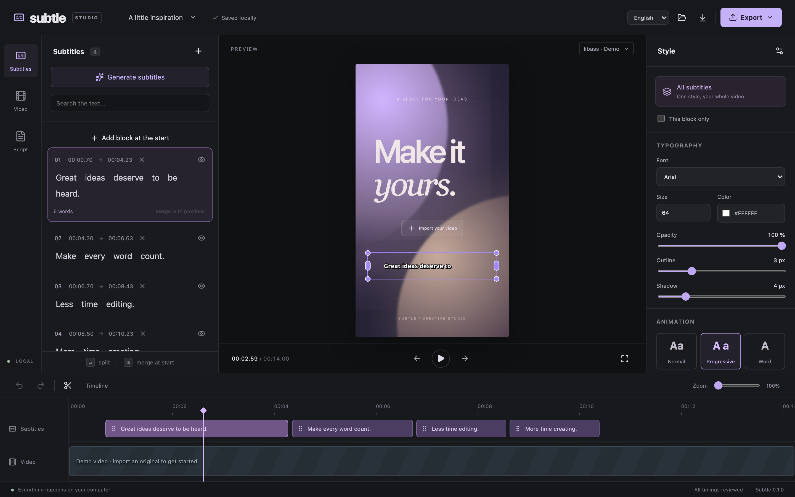
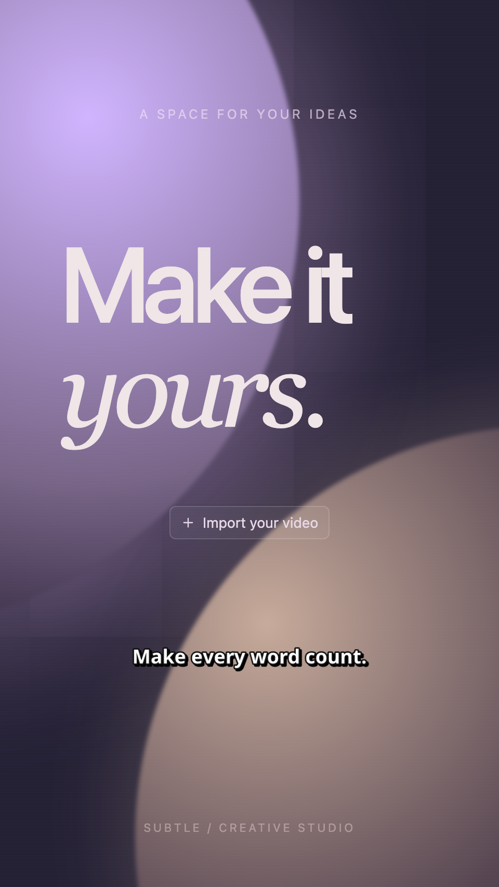
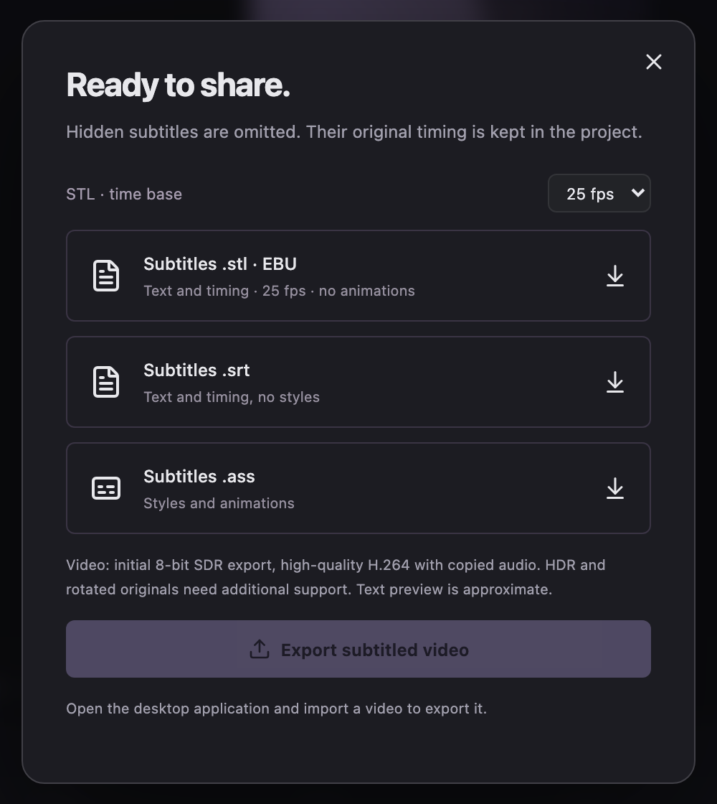

<div align="center">

# Subtle

**A local-first subtitle editor for vertical video.**

Transcribe, edit and style captions for shorts, reels and stories, then burn them into the original video without it ever leaving your computer.

[](https://github.com/develatter/subtle/actions/workflows/check.yml)
[](LICENSE)




</div>

## Features

- **Automatic transcription, fully offline.** Whisper (via [stable-ts](https://github.com/jianfch/stable-ts)) runs locally with language detection and word-level timestamps. Audio never leaves your machine.
- **Word-level editing that respects timing.** Every word keeps its own start and end. Fixing a typo, hiding a word or splitting a block never shifts its neighbours.
- **Text-editor ergonomics.** <kbd>Enter</kbd> splits a block, <kbd>Backspace</kbd> at the start merges it with the previous one, <kbd>Shift</kbd>+<kbd>Enter</kbd> adds a line break, and undo/redo keeps the last 100 operations.
- **Timeline.** Drag blocks, zoom with <kbd>Ctrl</kbd> + wheel and resize the panel. Changing a block's edges scales its inner word timings proportionally.
- **Styling and animation.** Pick the font, size, colour, outline, shadow and position, then choose an animation: normal, progressive reveal or word by word. Styles apply globally or per block.
- **Accurate preview.** The preview is rendered with [libass](https://github.com/libass/libass), the same engine used for the final export (native in the app, WASM in the browser).
- **Lossless-minded export.** The original is re-encoded to H.264 with its presentation timestamps, audio and colour metadata preserved. Subtitles can also be exported as SRT, ASS or EBU STL.
- **Safe persistence.** Sessions are saved with atomic writes and a validated backup. If a video is moved, it can be relinked without losing the subtitles.
- **English and Spanish** UI, native messages and speech worker.

<table>
  <tr>
    <td width="50%"></td>
    <td width="50%"></td>
  </tr>
  <tr>
    <td align="center"><sub>Full-screen preview rendered with libass</sub></td>
    <td align="center"><sub>Export to MP4, SRT, ASS or EBU STL</sub></td>
  </tr>
</table>

## Getting started

### Requirements

- Node 22+
- Stable Rust
- FFmpeg built with libass, plus ffprobe
- Python 3 for the transcription worker
- On Linux, the [Tauri prerequisites](https://v2.tauri.app/start/prerequisites/) (WebKitGTK 4.1, GTK, …)

### Run the desktop app

```sh
npm install
python3 -m venv .venv
.venv/bin/pip install -r scripts/requirements.txt
npm run desktop
```

The launcher picks up `.venv/bin/python` automatically. To use another interpreter, set `SUBTLE_PYTHON` to its absolute path. The first transcription downloads the Whisper `small` model into `.models/`.

### Web-only mode

```sh
npm run dev   # http://127.0.0.1:1420
```

This runs the editor in the browser with a demo project and supports SRT/ASS/STL export. Transcription and video export need the native app.

## Development

| Command                                             | What it does                               |
| --------------------------------------------------- | ------------------------------------------ |
| `npm test`                                          | Domain and persistence tests (`node:test`) |
| `npm run test:ui`                                   | Playwright smoke test of the interface     |
| `npm run build`                                     | Type-check and build the frontend          |
| `npm run check:export`                              | Real export round-trip with FFmpeg         |
| `npm run format`                                    | Prettier                                   |
| `cargo test --manifest-path src-tauri/Cargo.toml`   | Rust tests                                 |
| `cargo clippy --manifest-path src-tauri/Cargo.toml` | Lints (kept warning-free)                  |
| `python3 scripts/check-speech.py`                   | Speech worker checks                       |

Contribution rules (architecture, style, what must not break) are in [`AGENTS.md`](AGENTS.md).

### Architecture

The frontend is layered, and dependencies only point inwards: **UI → application → domain**.

| Layer          | Path                  | Responsibility                                                                                                              |
| -------------- | --------------------- | --------------------------------------------------------------------------------------------------------------------------- |
| Domain         | `src/domain/`         | Project model, editing operations, validation, segmentation and SRT/ASS/STL exporters. No React or Tauri; errors are codes. |
| Application    | `src/application/`    | Use cases (media, transcription, export, editing) and the ports they need from the environment.                             |
| Infrastructure | `src/infrastructure/` | Port implementations: Tauri commands and browser fallbacks.                                                                 |
| State          | `src/state/`          | Zustand stores for the project (history and persistence) and the UI.                                                        |
| UI             | `src/ui/`             | Components per panel, lifecycle hooks and styles per area.                                                                  |
| i18n           | `src/i18n/`           | Typed dictionaries and translator.                                                                                          |

The Rust backend (`src-tauri/src/`) has one module per capability: `media`, `preview`, `export`, `speech`, `fonts`, `documents`, `persistence`, `jobs`, `process` and `i18n`. Native work runs as cancellable jobs with progress, one at a time, so the UI never blocks.

## Export details

| Format  | Notes                                                                                                                                                                      |
| ------- | -------------------------------------------------------------------------------------------------------------------------------------------------------------------------- |
| **MP4** | Re-encodes the original with H.264 (CRF 14, preset slow). Keeps presentation timestamps (`fps_mode passthrough`, `enc_time_base demux`), copies audio and colour metadata. |
| **ASS** | Full styling, position and the three animation modes.                                                                                                                      |
| **SRT** | Text and timing per block.                                                                                                                                                 |
| **STL** | EBU Tech 3264, Latin ISO 6937, 25 or 30 fps time base, two lines of up to 42 characters. Rejects unsupported characters instead of altering them.                          |

Some Android and WhatsApp recordings have no edit list, and their first frame carries a positive composition offset. Apple players show these from 0, but FFmpeg would write an empty lead-in, which causes a black first frame and audio drift. For these files only, the video is shifted so that the first frame lands on 0. Frame intervals and audio are left untouched. Originals with an edit list keep their exact timestamps.

Video export currently supports 8-bit SDR `yuv420p` without rotation metadata. HDR, 10-bit and incompatible audio are rejected explicitly, never silently converted. Output is published only after completion, and existing files are never overwritten.

## Packaging for macOS

```sh
.venv/bin/pip install -r scripts/requirements-macos-arm64.lock.txt
npm run release:mac
```

This bundles the Python worker (PyInstaller), FFmpeg/ffprobe with their libraries and the Whisper `small` model into a self-contained `Subtle.app`. The current build targets Apple Silicon on macOS 26 or later. When `APPLE_ID`, `APPLE_PASSWORD` and `APPLE_TEAM_ID` (or an App Store Connect API key) are set, Tauri signs and notarizes the app as part of the build.

## Roadmap

- Validate the standalone bundle on a clean Mac and produce Linux packages.
- Broader render-equivalence tests between native and WASM libass.
- Automatic proxy selection for heavy originals.
- HDR/10-bit, rotation and more audio/container formats.
- Script-vs-audio mismatch detection to speed up proofreading.
- Signed installers.

## License

Subtle is free software: you can redistribute it and/or modify it under the terms of the [GNU General Public License](LICENSE), either version 3 of the License or (at your option) any later version.

The standalone bundle ships third-party components under their own licenses. The bundled FFmpeg is built with `--enable-gpl --enable-version3` and runs as a separate process. Whisper, stable-ts and the `small` model are MIT, and Noto Sans is OFL. License texts are copied into `runtime/media/licenses/` and `runtime/python-licenses/` at build time.

Built on [Tauri](https://v2.tauri.app/), [FFmpeg](https://ffmpeg.org/), [stable-ts](https://github.com/jianfch/stable-ts), [Whisper](https://github.com/openai/whisper) and [libass](https://github.com/libass/libass).
